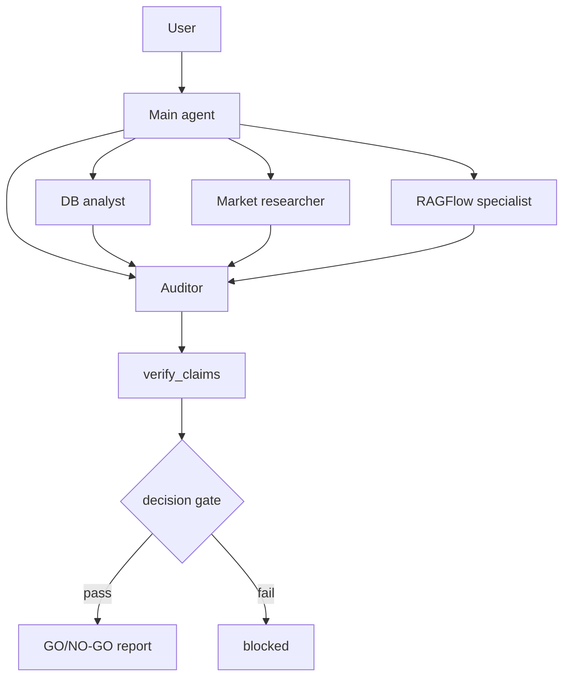

# DeepAgent Ops

> Multi-agent cross-border operations decisions with a deterministic, fail-closed audit gate.

<!-- Replace OWNER/REPO after publishing. -->


## Why

LLM agents sound confident and are bad at arithmetic. A second "audit agent"
using the same model and tools is not an audit: it repeats the same mistake and
confirms it.

This project replaces the second opinion with a **deterministic recomputation**
and a **decision gate**: if the numbers cannot be verified, no GO/NO-GO answer
is allowed through.

## What it does

- main agent + 4 sub-agents: DB analyst, market researcher, RAGFlow policy
  specialist, auditor;
- MySQL + Tavily + RAGFlow data sources;
- business SOP tools (margin / return rate / turnover / slow-moving);
- `verify_claims` + `agent-audit` for deterministic checks;
- `【决策回执】` + `decision_gate` for a runtime gate;
- FastAPI + WebSocket progress + Vue3 UI;
- read-only MySQL session and session-scoped file sandbox.

## Architecture



## Quickstart

```bash
# 1. MySQL (docker) — optional for unit tests
docker compose up -d

# 2. Python (agent-audit is vendored; one clone is enough)
uv sync

# 3. Config
cp .env.example .env
# fill MySQL / DashScope / RAGFlow / Tavily

# 4. Tests (no external services)
uv run pytest -q

# 5. Audit demo (no DB / API key)
uv run python examples/audit_demo.py

# 6. Backend + frontend
python main.py
cd ui && npm install && npm run dev
```

## Evaluation

| Case group | Result |
|---|---|
| A1–B5 (data + business calc) | **9/9 PASS** |
| C1/C2 | blocked by decision gate |
| C3 | 480s timeout (open) |
| D1/D2 | PASS |
| D3 | model emitted a stocking report instead of refusing (open) |

> `result.combined.json` is `valid=false`; 73.3% is **not** a clean quality
> metric. See `evaluation/` for the raw records.

## Limitations

- C3 latency and D3 behavior are open;
- audit covers numeric claims, not business judgment;
- no auth / multi-tenant isolation;
- SQLite-free but single-process task state;
- PDF export is Windows/Word-only.

## License

MIT
